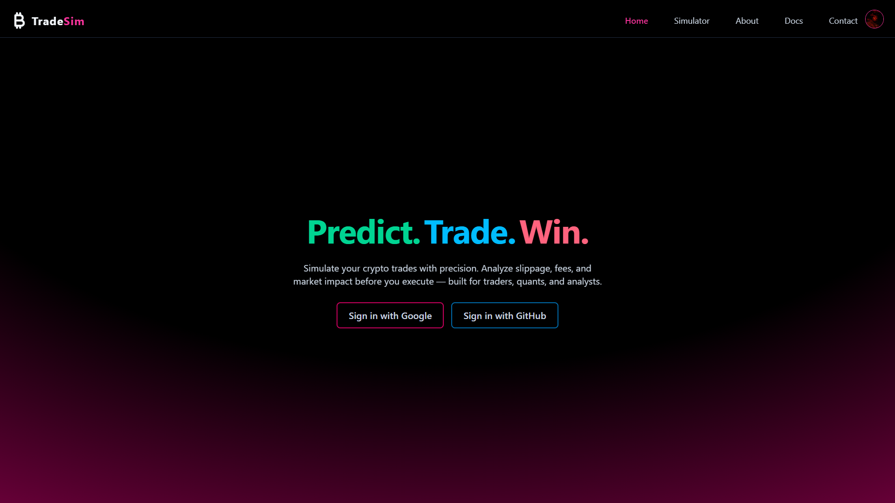
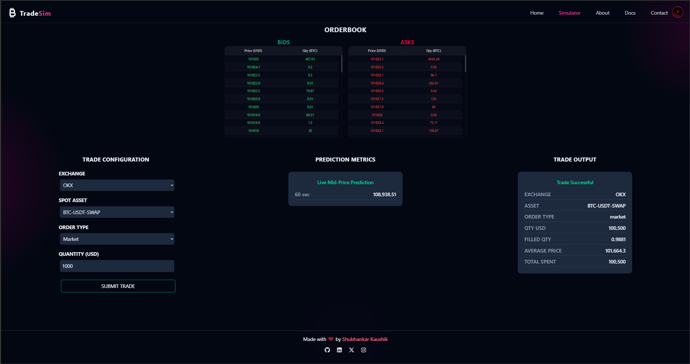
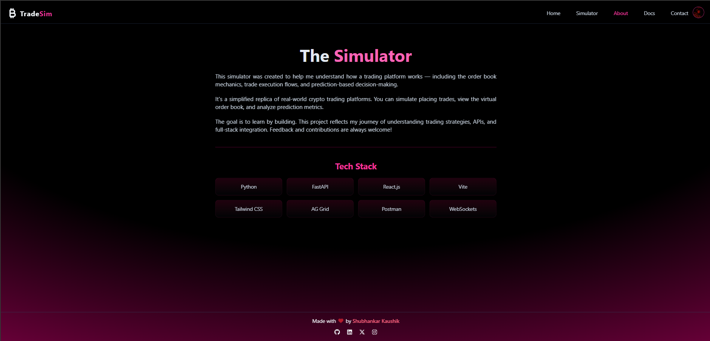
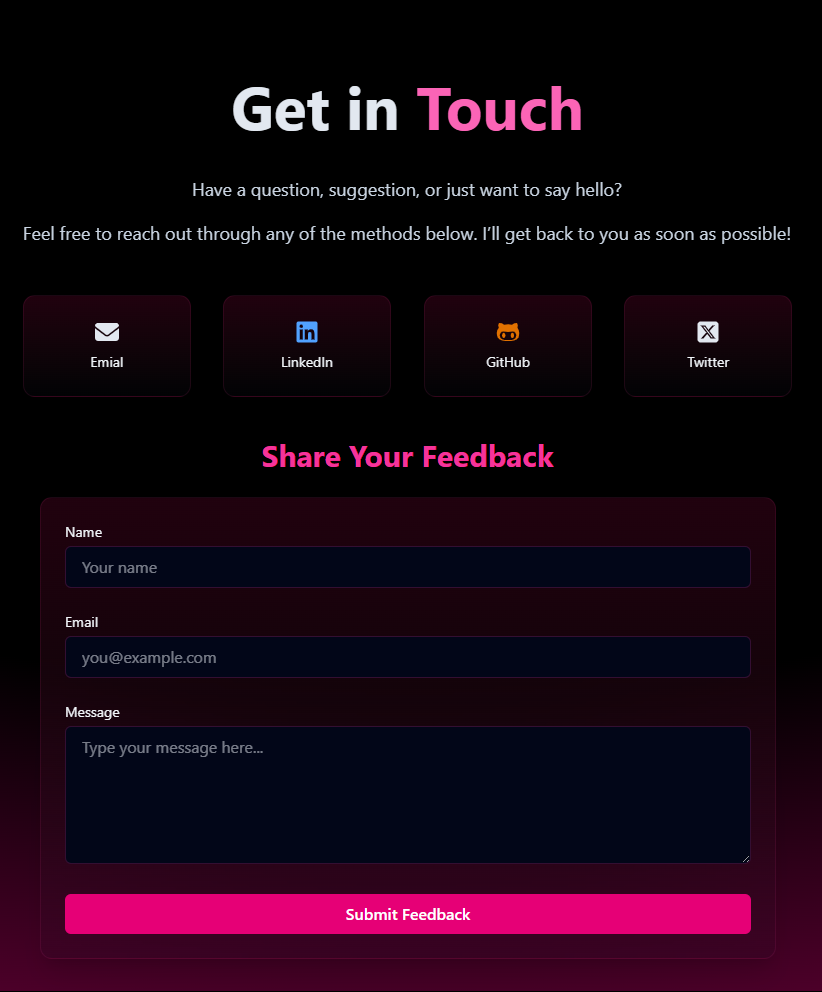
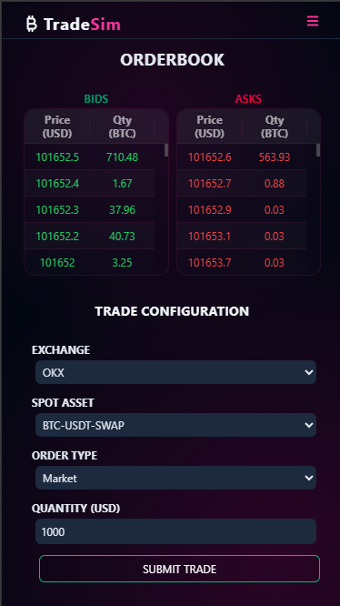

# 🚀 TradeSim

**TradeSim** is a **real-time crypto trade simulator**. It streams a live OKX `BTC-USDT-SWAP` order book, simulates market orders against it, showing fill, fees and slippage, and predicts the **mid-price 60 seconds ahead** with a machine-learning model.

[](https://tradesim-shubhabha.vercel.app/)
[](https://punosie.github.io/TradeSim/)


---

## 🧠 Features

- ⚡ **Live Order Book**: one upstream feed is fanned out to every viewer over WebSockets and rendered at screen refresh rate.
- 📈 **60-Second Price Prediction**: a gradient-boosted model predicts the relative mid-price move, so it tracks the live price level.
- 🏦 **Market Order Simulation**: walks the book level by level to report fill quantity, average price, tiered fees, slippage and latency.
- 🗂️ **Trade History**: every simulated trade is saved per user (MongoDB) and downloadable as CSV.
- 🤖 **Ask AI**: a Gemini-powered assistant for trading and market-structure questions.
- 🔐 **Sign in with Google or GitHub** (Firebase Auth).
- 📱 **Fully responsive**, with per-page SEO metadata, Open Graph cards, a sitemap and an installable web manifest.

---

## 🌐 Live App

🔗 [Launch TradeSim](https://tradesim-shubhabha.vercel.app/) · API: `https://tradesim-alce.onrender.com`

## 🎥 Demo Video

[](https://youtu.be/nPfPSmC5w-M)
➡️ *(Click to watch on YouTube)*

---

## 🖥️ Interface Overview

| Home | Simulator |
|---|---|
|  |  |

| About | Contact | Mobile |
|---|---|---|
|  |  |  |

---

## 🏗️ Architecture

```text
          OKX order book feed
                  │  one connection, auto-reconnect
                  ▼
   ┌──────────── FastAPI (Render) ────────────┐
   │            OrderbookHub                  │
   │   latest snapshot ─► POST /simulate/trade ──► MongoDB
   │   per-tick fan-out ─► /ws/okx             │
   │   ML model (once/tick) ─► /ws/prediction  │
   │   Gemini ─► POST /ask-ai                  │
   └──────────────────────────────────────────┘
                  ▲  REST (Firebase ID token) + WebSockets
                  │
        React 19 + Vite SPA (Vercel)
```

| Layer    | Stack |
|----------|-------|
| Frontend | React 19, Vite 8, React Router, Tailwind CSS 4, AG Grid, Firebase Auth, react-markdown + KaTeX |
| Backend  | Python 3.14, FastAPI, Uvicorn, websockets, orjson, async PyMongo, Firebase Admin, Google Gen AI |
| ML       | scikit-learn `GradientBoostingRegressor` on scale-free order book features |
| Hosting  | Vercel (frontend), Render (backend), MongoDB Atlas, GitHub Pages (docs) |

---

## 🛠️ Local Setup

### Prerequisites

- Python **3.14** (uv recommended)
- Node.js **22.22+** (24 LTS recommended)
- A Firebase project (web app + service account), a MongoDB connection string and a Gemini API key

### Backend

```bash
cd backend
uv venv --python 3.14 .venv          # or: python -m venv .venv
uv pip install -r requirements.txt   # or: .venv/bin/pip install -r requirements.txt
cp .env.example .env                 # fill in MONGO_URL, WS_ENDPOINT, GOOGLE_API_KEY
# Save the Firebase Admin service account JSON as app/firebase-adminsdk.json
.venv/bin/python server.py           # Windows: .venv\Scripts\python server.py
```

The API runs at `http://127.0.0.1:8000`, with interactive docs at `/docs`.

To retrain the prediction model on `dataSample/training_data.json`:

```bash
python train_model.py            # writes app/regression_models/mid_price_60.pkl
pip install -r requirements-dev.txt && python train_model.py --plot
```

### Frontend

```bash
cd frontend
npm install
cp .env.example .env    # Firebase web config, EmailJS keys, backend URLs
npm run dev             # http://localhost:5173
npm run lint && npm run build
```

### Docs

```bash
cd docs
npm install
npm start
```

---

## 🚢 Deployment

### Backend on Render

[`render.yaml`](./render.yaml) describes the service. It runs from `backend/` on Python 3.14 with a single Uvicorn worker (the order book hub is in-process state) and uses `/health` as its health check.

1. Set the `MONGO_URL`, `WS_ENDPOINT` and `GOOGLE_API_KEY` env vars, and adjust `CORS_ORIGINS` if your frontend lives elsewhere. Vercel preview URLs are already allowed by `CORS_ORIGIN_REGEX`.
2. Upload the Firebase service account as the **secret file** `firebase-adminsdk.json`. With `IS_RENDER=true` it's read from `/etc/secrets/`.

### Frontend on Vercel

The Vercel project's root directory is `frontend/` (framework preset: Vite). [`frontend/vercel.json`](./frontend/vercel.json) adds the SPA fallback, immutable caching for hashed assets and security headers.

```bash
vercel link              # from the repo root
vercel deploy            # preview
vercel deploy --prod     # production
```

Set `VITE_API_URL=https://<render-service>.onrender.com`, `VITE_WS_URL=wss://<render-service>.onrender.com`, the `VITE_FIREBASE_*` values and the EmailJS keys in the Vercel project. Every `VITE_*` value is bundled into public JavaScript, so never put secrets there.

---

## 📚 Documentation

Setup, architecture and API reference: 📘 [TradeSim Docs](https://punosie.github.io/TradeSim/)

---

## 👨‍💻 Developer

**Shubhankar Kaushik**
📧 [shubhankar.kaushik2003@gmail.com](mailto:shubhankar.kaushik2003@gmail.com)

---

## 📄 License

This project is licensed under the [MIT License](LICENSE).
